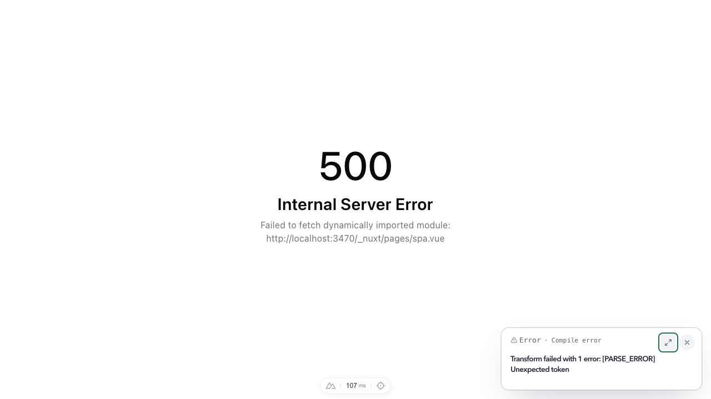
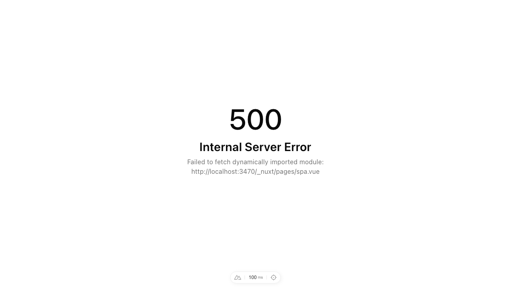

# Dev error overlay misses a compile error in a client-only page

Reproduction for the Nuxt 4.6 dev error overlay. When a module fails to compile and only the client imports it, as on a page with `ssr: false`, the overlay never shows the compile error. The page shows the generic error page instead, with `Failed to fetch dynamically imported module`.

- `nuxt-nightly@4.6.0-29844781.aec739e9` (built from `4.x` at [`aec739e`](https://github.com/nuxt/nuxt/commit/aec739e93d7d83cd25c8e7f15f6db555e51ca4b0)), `my-bad@0.2.9`, Vite 8.3.1, Node 24.15, macOS
- The same code is on `main` ([`dev-errors.ts#L218-L221`](https://github.com/nuxt/nuxt/blob/main/packages/vite/src/dev-errors.ts#L218-L221)).

## Steps

```sh
npm install
npm run dev
```

1. Open <http://localhost:3000/ssr>. The page imports `app/lib/broken-ssr.ts`, which has a syntax error. The compile error overlay shows up.
2. Open <http://localhost:3000/spa>. This is the same page, with `ssr: false` from `routeRules`, importing `app/lib/broken-spa.ts`.

## Expected

`/spa` shows the compile error overlay, as `/ssr` does. The terminal prints the error either way.



## Actual

`/spa` shows only the generic error page, `500 Internal Server Error: Failed to fetch dynamically imported module: …/pages/spa.vue`, and no overlay. This happens on every load, fresh server or not.



`/ssr` is not affected: the server render fails too, so the overlay comes embedded in the error page's HTML.

## Cause

`/spa` renders on the client only, so the compile error happens while the app initialises. The router loads the page before the `dev-error-overlay` plugin is listening. So the chain is:

1. The reporter pushes the compile report over HMR, as `nuxt:dev:error`. It also pushes it again on `vite:client:connect` ([`dev-errors.ts#L224-L228`](https://github.com/nuxt/nuxt/blob/aec739e93d7d83cd25c8e7f15f6db555e51ca4b0/packages/vite/src/dev-errors.ts#L224-L228)). Both sends reach the page before the plugin subscribes ([`dev-error-overlay.client.ts#L22`](https://github.com/nuxt/nuxt/blob/aec739e93d7d83cd25c8e7f15f6db555e51ca4b0/packages/nuxt/src/app/plugins/dev-error-overlay.client.ts#L22)). In the WebSocket frames, `nuxt:dev:error` arrives a few milliseconds before the plugin's own `nuxt:dev:error:shown`, and the plugin never mounts the overlay.
2. The browser then reports the failed import as `nuxt:dev:client-error`. `reportRuntimeError` recognises it as the consequence of the compile error, and returns without doing anything ([`dev-errors.ts#L242-L246`](https://github.com/nuxt/nuxt/blob/aec739e93d7d83cd25c8e7f15f6db555e51ca4b0/packages/vite/src/dev-errors.ts#L242-L246)).

At that point the page is listening, but nothing sends the report again. The branch just below it does resend `pendingOverlay` for a runtime error it has seen before ([`#L248-L253`](https://github.com/nuxt/nuxt/blob/aec739e93d7d83cd25c8e7f15f6db555e51ca4b0/packages/vite/src/dev-errors.ts#L248-L253)). The import-failure branch is the only way out of `reportRuntimeError` that does not.

## Possible fix

Resend the current report when the follow-on import failure is swallowed:

```diff
     // a module the browser could not import failed to compile, which is already reported
     if (file
  && !isRuntime && IMPORT_FAILURE_RE.test(error.message)) {
+      // the report may have been pushed before the page was listening for it
+      if (pendingOverlay) {
+        server.environments.client?.hot.send(pendingOverlay)
+      }
       return
     }
```

Applied to the nightly's `@nuxt/vite-builder/dist/index.mjs`, `/spa` shows the compile error overlay on each of three loads (the screenshot under Expected). Without the change it shows no overlay on any of them.
